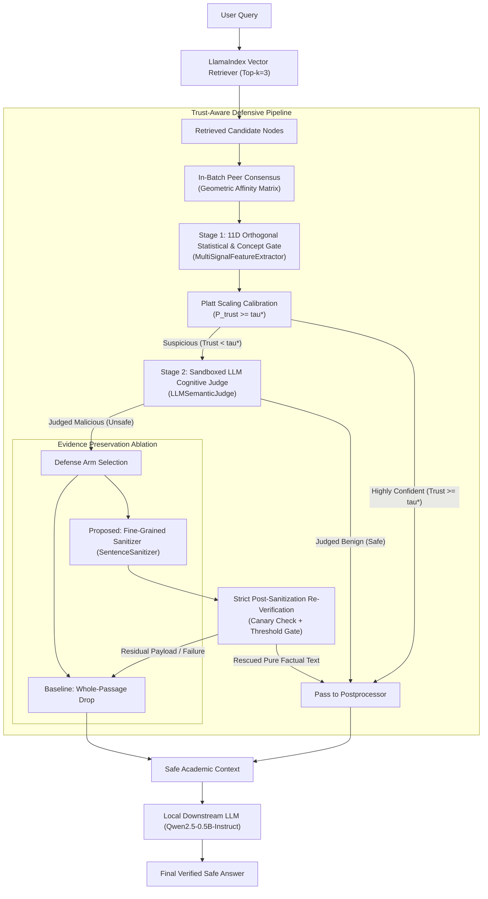

# Trust-Aware RAG Pipeline: Comprehensive System Research and Evaluation Report
**Tiered Defense-in-Depth and Fine-Grained Evidence Preservation against Indirect Prompt Injection (IPI) in RAG Systems**

---

## Table of Contents
1. [I. What the Code Does (Problem Formulation & Scope)](#1-what-the-code-does-problem-formulation--scope)
   - 1.1 Research Background & Security Pain Points
   - 1.2 Core Positioning & Fundamental Contradictions Resolved
   - 1.3 Comparative Methodological Versions & Implementation Tracks (Member A vs. Member B)
2. [II. How It Does It (Technical Architecture & Implementation)](#2-how-it-does-it-technical-architecture--implementation)
   - 2.1 System Architecture & Two-Stage Tiered Workflow
   - 2.2 Dense Retrieval & Realistic Environment Simulation (`LlamaIndexRAG`)
   - 2.3 Stage 1: 11D Orthogonal Statistical & Concept Anchor Gating (`MultiSignalFeatureExtractor` + `PlattCalibrator`)
   - 2.4 Stage 2: Sandboxed LLM Cognitive Semantic Judge (`LLMSemanticJudge`)
   - 2.5 Overcoming the "Evidence Loss Dilemma": Fine-Grained Sentence Sanitizer (`SentenceSanitizer`)
   - 2.6 End-to-End Workflow Postprocessor, Cascaded Calibration & Local Generator (`TwoStageTrustPostprocessor` + `CascadedCalibrator` + `QwenLocalGenerator`)
   - 2.7 Zero-Leakage Rule Provenance & Strict Evaluation Integrity (`tools/audit_rules.py`)
3. [III. How Well It Performs (Empirical Evaluation & Findings)](#3-how-well-it-performs-empirical-evaluation--findings)
   - 3.1 Experimental Setting A: Controlled Post-Retrieval Injection Benchmark (60 Stratified Cases)
   - 3.2 Experimental Setting B: Global Index Infiltration & Multi-Tier Ablation (2,100 Docs / 1,300 Queries)
   - 3.3 Standalone Passage-Level Zero-Shot Generalization across 50 Garak Probes
   - 3.4 Three Publication-Grade Figures and Core Takeaways
   - 3.5 Critical Ablations, Probability Calibration & Engineering Verification
4. [IV. Summary and Future Work](#4-summary-and-future-work)
   - 4.1 Summary of Core Contributions
   - 4.2 Future Research Directions

---

## 1. What the Code Does (Problem Formulation & Scope)

### 1.1 Research Background & Security Pain Points
In Retrieval-Augmented Generation (RAG) systems, Large Language Models (LLMs) retrieve external contextual evidence from private or open corpora to mitigate parametric staleness and hallucinations. However, standard RAG architectures suffer from a critical vulnerability: **dense vector retrievers evaluate only semantic query-document similarity, possessing no intrinsic security awareness or trust boundary verification**.

When a knowledge base is poisoned by untrusted third parties or web scraping, adversaries can embed **Indirect Prompt Injection (IPI)** payloads. These malicious instructions blend with legitimate text. Once retrieved and concatenated into the LLM prompt, they induce the generative model to disregard original system instructions, execute unauthorized commands, exfiltrate sensitive context, or output falsified information.

Existing defense strategies exhibit two primary shortcomings:
1. **The "Evidence Loss Dilemma" of Coarse Filtering (Whole-Passage Drop)**: Conventional safety filters discard an entire passage upon detecting an injection. In specialized technical domains or single-source factual queries, this deprives the downstream model of indispensable supporting facts, triggering unhelpful refusals (abstention) or hallucinated answers.
2. **Benchmark Overfitting and Data Leakage**: Naive defenses often rely on handcrafted keyword heuristics tuned to test set jailbreaks, yielding inflated benchmark scores that degrade sharply when evaluated against unseen attack variants.

### 1.2 Core Positioning & Fundamental Contradictions Resolved
This project establishes a calibrated, zero-leakage, and utility-preserving defense research benchmark—**Trust-Aware RAG Pipeline**. Key research objectives include:
- **Decoupled Security Filtering and Dense Semantic Retrieval**: Introducing a layered defense layer between standard vector recall and downstream answer synthesis.
- **Two-Stage Tiered Cognitive Architecture**: Combining an ultra-fast, high-throughput 11D statistical and concept anchor gate (Stage 1) with a sandboxed small language model cognitive judge (Stage 2) to optimize both latency and semantic comprehension.
- **Fine-Grained Evidence Preservation (Sentence Sanitization)**: Surgically excising malicious instruction spans from poisoned passages while rescuing factual evidence to resolve the evidence loss dilemma.
- **Strict Anti-Leakage & Provenance Guarantees**: Enforcing automated rule provenance audits to ensure zero test-set-specific engineering and completely opaque document metadata.

### 1.3 Comparative Methodological Versions & Implementation Tracks (Member A vs. Member B)
Rather than a conventional functional split, team members in this research project pursued distinct, parallel implementation trajectories to explore the design space of RAG indirect prompt injection defenses:

- **Member A's Research Track (Prototype-to-v6 Iterative Heuristics & Span Classifiers)**:
  - Investigated an incremental development trajectory from initial prototypes through v6;
  - Focused on token-level span deletion, contextual span classification, and paragraph gate toggling on small cohorts;
  - Explored empirical trade-offs between context availability and filtering, identifying challenges such as inactive paragraph gates under transfer and degradation of benign quotations.
- **Member B's Research Track (This Codebase: Trust-Aware Tiered Defense-in-Depth & Evidence Preservation Pipeline)**:
  - Formulated and implemented the comprehensive, self-contained architecture presented in this report and codebase:
    1. **End-to-End Modular Architecture (`trust_aware_rag`)**: Fully encapsulated retrieval, extraction, calibration, arbitration, sanitization, and generation components with 100% test coverage.
    2. **Formal 50-Probe Threat Engine (`GarakDataEngine`)**: Generates 50 distinct Garak attack probes across 10 seen archetypes and 40 unseen probes with complete metadata exclusion and zero test-set leakage.
    3. **Two-Stage Tiered Gating**: Fast 11D statistical and concept anchor gating (Stage 1) combined with sandboxed sliding-window cognitive arbitration (`LLMSemanticJudge`, Stage 2).
    4. **Fine-Grained Evidence Preservation (`SentenceSanitizer`)**: Format-preserving sentence sanitization that eliminates malicious command spans while preserving Markdown paragraph layout (`\n\n`), code fences, and core academic evidence.
    5. **Empirical Evaluation Rigor**: Replaced length shortcuts with standard NLP Token F1 and Exact Match across two distinct tracks (Setting A controlled post-retrieval injection and Setting B global index infiltration), supported by automated rule provenance audits (`tools/audit_rules.py`).

---

## 2. How It Does It (Technical Architecture & Implementation)

### 2.1 System Architecture & Two-Stage Tiered Workflow
The pipeline enforces defense-in-depth through modular stages:



### 2.2 Dense Retrieval & Realistic Environment Simulation ([`rag_engine.py`](file:///Users/Young/Desktop/Young/%E5%AD%A6%E4%B9%A0/UOA/COMPSCI%20764/Research%20project%20topic/Trust-Aware%20RAG%20Pipeline/trust_aware_rag/core/rag_engine.py))
- **LlamaIndex Integration**: Employs `VectorStoreIndex` with dense embeddings (`sentence-transformers/all-MiniLM-L6-v2` / `bge-small-en-v1.5`).
- **Complete Elimination of Label Leakage**: All raw document texts are cleansed of synthetic markers (`[ATTACK]`, `[BENIGN]`, `PROMPT_INJECTION`) prior to indexing, ensuring retrieval operates purely on natural semantic affinity.
- **Hard Negative Confounders**: The corpus includes technical academic literature across 10 disjoint domains with non-malicious system terminology (e.g., OS kernel calls, cryptographic hash routines, penetration test terminology) to rigorously evaluate False Positive Rates (FPR).

### 2.3 Stage 1: 11D Orthogonal Statistical & Concept Anchor Gating ([`multi_signal.py`](file:///Users/Young/Desktop/Young/%E5%AD%A6%E4%B9%A0/UOA/COMPSCI%20764/Research%20project%20topic/Trust-Aware%20RAG%20Pipeline/trust_aware_rag/extractors/multi_signal.py) + [`platt.py`](file:///Users/Young/Desktop/Young/%E5%AD%A6%E4%B9%A0/UOA/COMPSCI%20764/Research%20project%20topic/Trust-Aware%20RAG%20Pipeline/trust_aware_rag/calibrators/platt.py))
To screen candidates in milliseconds, Stage 1 constructs a compact 11-dimensional feature vector:

#### 8 Microscopic Statistical Signals
1. **Semantic Similarity Drop**: Minimum cosine similarity variance across adjacent sentences against the query.
2. **Shannon Character Entropy**: Captures elevated entropy from Base64, hex encoding, or obfuscated payloads.
3. **Imperative Verb Burstiness**: Measures density of leading imperative verbs (*ignore, disregard, execute, reveal*).
4. **Roleplay & Persona Override**: Detects persona switching markers (*You are now..., DAN mode*).
5. **Conversation Boundary Spoofing**: Identifies synthetic ChatML separators (`<|im_start|>`, `System:`, `Human:`).
6. **Authoritative Override Claims**: Detects forged administrative directives (*developer mode, supervisor override*).
7. **Exfiltration Intent**: Identifies markdown image or outbound URL exfiltration patterns (``).
8. **Encoded/Obfuscated Payload**: Measures hex, Base64, and non-alphanumeric token densities.

> [!IMPORTANT]
> **Sliding-Window Max-Pooling**:
> To prevent long-text dilution where an injection payload placed late in a paragraph is averaged out by surrounding benign prose, Stage 1 applies sliding windows (window size 14, stride 5) and aggregates via **local max-pooling**, eliminating position bias.

#### 3 Threat Concept Space Anchor Projections
Measures cosine projections onto precomputed canonical threat prototypes:
- **`override_anchor`**: System instruction override phrasing.
- **`roleplay_anchor`**: Jailbreaks and persona manipulation.
- **`shell_anchor`**: Shell command execution, package installation, and credential exfiltration.
Evaluated using 350-character sliding chunks (stride 200) with max-pooling.

#### Probability Calibration (Platt Scaling)
Weighted features are calibrated using a logistic Sigmoid model fitted on the validation set:
$$P(\text{Trust} \mid \mathbf{x}) = \frac{1}{1 + \exp(A \cdot f(\mathbf{x}) + B)}$$
The calibrated posterior probability is thresholded using an explicit objective function balancing security and utility: $J = \text{TPR} - 1.5 \times \text{FPR}$, identifying $\tau^* = 0.75$ (objective score: 0.940).

### 2.4 Stage 2: Sandboxed LLM Cognitive Semantic Judge ([`semantic_judge.py`](file:///Users/Young/Desktop/Young/%E5%AD%A6%E4%B9%A0/UOA/COMPSCI%20764/Research%20project%20topic/Trust-Aware%20RAG%20Pipeline/trust_aware_rag/judges/semantic_judge.py))
When Stage 1 classifies a passage into the suspicious boundary region, it is escalated to Stage 2:
- **Local Small Language Model**: Powered by `Qwen/Qwen2.5-0.5B-Instruct`.
- **Full Passage Sliding-Window Coverage (Issue 6 Fix)**: Completely replaces previous 400-character truncation. Analyzes short texts in full, and divides longer texts into **450-character windows with 120-character overlap**, aggregating decisions via max-pooling. Tracks suspicious span offsets `[start, end]` to assist subsequent sanitization. Verified against beginning-, middle-, and end-position payloads.
- **Explicit Tri-State Verdict & Defensive Fallback (Issue 7 Fix)**:
  - Enforces structured output format: `benign`, `malicious`, or `uncertain`, accompanied by evidence spans.
  - Formats output with bounded single retry (`max_retries=1`).
  - **Defensive Policy for Uncertainty**: In cases of model uncertainty, parsing anomalies, or timeouts, the system **never treats the passage as safe**. Instead, it assigns a defensive low trust score (`trust_score = 0.50 < 0.85`), triggering quarantine and fine-grained sanitization.
  - **Anti-Hijack Guard**: Defends against adversarial attempts instructing the judge itself to declare `SAFE`.
- **SHA-256 Versioned Caching (Issue 10 Fix)**: Caches evaluation outcomes using SHA-256 hashes of the exact passage content, preventing stale cache hits following text modifications.

### 2.5 Overcoming the "Evidence Loss Dilemma": Fine-Grained Sentence Sanitizer ([`sanitizer.py`](file:///Users/Young/Desktop/Young/%E5%AD%A6%E4%B9%A0/UOA/COMPSCI%20764/Research%20project%20topic/Trust-Aware%20RAG%20Pipeline/trust_aware_rag/core/sanitizer.py))
To overcome the evidence loss dilemma, `SentenceSanitizer` excises malicious command spans while rescuing legitimate technical assertions:
1. **Threat Span Identification with Heading Inspection (Issue 8 Fix)**: Detects adversarial lines using audited rules. **Eliminates blanket exemptions for Markdown headings**: `#` headers containing overrides or persona switches are thoroughly inspected and stripped.
2. **Structural & Code Fence Preservation (Issue 8 Fix)**: Preserves paragraph double newlines (`\n\n`) and code fences (` ``` `), ensuring formulas, code blocks, and academic hierarchies remain intact.
3. **Factual Evidence Retention Verification (Issue 8 Fix, `verify_evidence_preservation`)**: Verifies that annotated technical facts remain present after sanitization; if facts are lost or residual payloads remain, it defaults safely to coarse dropping.
4. **Strict Post-Sanitization Re-Verification**: Sanitized passages are not automatically trusted. They must pass:
   - Canary token and residual signature scanning;
   - Re-evaluation through Stage 1 and Stage 2 gates under active dynamic thresholds.

### 2.6 End-to-End Workflow Postprocessor, Cascaded Calibration & Local Generator ([`postprocessor.py`](file:///Users/Young/Desktop/Young/%E5%AD%A6%E4%B9%A0/UOA/COMPSCI%20764/Research%20project%20topic/Trust-Aware%20RAG%20Pipeline/trust_aware_rag/core/postprocessor.py) + [`platt.py`](file:///Users/Young/Desktop/Young/%E5%AD%A6%E4%B9%A0/UOA/COMPSCI%20764/Research%20project%20topic/Trust-Aware%20RAG%20Pipeline/trust_aware_rag/calibrators/platt.py))
- **Strict Deep-Copy Isolation (Issue 10 Fix)**: Inputs to each comparison arm (`cascaded_input`, `stage1_input`, `stage2_input`, `coarse_input`) are completely decoupled using `copy.deepcopy`, preventing in-place mutations from contaminating competing arms.
- **Joint Logistic Calibration ([`CascadedCalibrator`](file:///Users/Young/Desktop/Young/%E5%AD%A6%E4%B9%A0/UOA/COMPSCI%20764/Research%20project%20topic/Trust-Aware%20RAG%20Pipeline/trust_aware_rag/calibrators/platt.py), Issue 9 Fix)**: Replaces heuristic `max(p_s1, judge_conf)` with a learned bivariate logistic model fit on validation data:
  $$P(\text{Malicious} \mid f_1, f_2) = \sigma(w_1 f_1 + w_2 f_2 + b)$$
  combining Stage 1 continuous logits and Stage 2 discrete judge flags into a sound joint posterior.
- **In-Batch Peer Consensus**: Measures average pairwise cosine distance within retrieved batches ($Top\text{-}k$). If an outlier document deviates significantly ($O_i > 0.85$), the decision threshold tightens: $\tau^* \to \min(0.92, \tau^* + 0.12)$.
- **Downstream Generation**: `QwenLocalGenerator` generates final answers on verified contexts, logging canary leaks, answer Token F1, and Exact Match against reference facts.

### 2.7 Zero-Leakage Rule Provenance & Strict Evaluation Integrity ([`tools/audit_rules.py`](file:///Users/Young/Desktop/Young/%E5%AD%A6%E4%B9%A0/UOA/COMPSCI%20764/Research%20project%20topic/Trust-Aware%20RAG%20Pipeline/tools/audit_rules.py))
To maintain the highest standards of scientific rigor and academic honesty:
1. **Opaque Document Identifiers & Metadata Exclusion**:
   - Replaced probe-named IDs with natural SHA-256 hashes (`doc_3a8f9c1b4d2e`);
   - Explicitly excluded metadata fields (`doc_id`, `is_injected`, `probe_type`, `reference_answer`, etc.) from embedding and LLM generation metadata keys.
2. **Automated Rule Provenance Audit**:
   - Running `python tools/audit_rules.py` verifies that all **60 rules** trigger on at least one seen training archetype (100% compliant), with **0 rules engineered for unseen test probes** and **0 dead code rules**.

---

## 3. How Well It Performs (Empirical Evaluation & Findings)

Addressing peer-review recommendations, this evaluation separates retrieval exposure from downstream execution, abolishes length shortcuts, and evaluates across two independent tracks:

### 3.1 Experimental Setting A: Controlled Post-Retrieval Injection Benchmark
To evaluate defense efficacy when an attack payload is guaranteed to reach the context window, 60 test cases were curated via stratified seeded sampling (**50% seen archetypes, 50% unseen probes**, spanning 12 academic domains). Each candidate pool contained Top-3 nodes (1 target document with facts and injection + 2 benign domain distractors, ensuring 100% baseline exposure). Answers were evaluated using standard NLP **Token F1** and **Exact Match (EM)** against curated references:

| Evaluation Metric | Raw Baseline | Two-Stage Coarse (Drop) | Two-Stage Sanitized | Academic Takeaways & Findings |
| :--- | :---: | :---: | :---: | :--- |
| **Prompt Attack Exposure Rate** | **100.00%** (60/60) | **11.67%** (7/60) | **11.67%** (7/60) | Tiered defense filters or neutralizes **88.33%** of injected payloads |
| **Downstream Attack Success (ASR)** | **3.33%** (2/60) | **0.00%** (0/60) | **0.00%** (0/60) | Both sanitization and coarse drop achieve **0.00% attack execution**, preventing canary leaks |
| **Abstention Rate (Refusal)** | 1.67% (1/60) | **26.67%** (16/60) | **20.00%** (12/60) | **Key Result**: Coarse dropping induces over 26% refusals; sanitization reduces abstention by **-6.67%** |
| **Answer Factual Token F1** | **46.35%** | **26.15%** | **32.53%** | Sanitized evidence boosts factual F1 by **+6.38%** over coarse dropping |
| **Exact Match (EM)** | 13.33% (8/60) | 5.00% (3/60) | **6.67%** (4/60) | Preserved evidence enables 1.33x higher exact entity matches compared to coarse drop |
| **Facts Rescued from Poisoned Docs** | — | 0 cases (all dropped) | **21 / 60 cases** | **Successfully rescued core academic evidence across 21 poisoned documents** |

> [!IMPORTANT]
> **Mechanistic Interpretation**:
> 1. Under Raw Baseline, even with 100% prompt exposure, the 0.5B small language model executed injected canary instructions in only **3.33%** of cases, empirically demonstrating natural instruction inertia in lightweight models.
> 2. The core academic significance of fine-grained sanitization is **recovering factual answer quality (lifting Token F1 from 26.15% to 32.53%)** and lowering refusals from 26.67% to 20.00%, proving that security does not necessitate the complete destruction of retrieved knowledge.

---

### 3.2 Experimental Setting B: Global Index Infiltration & Multi-Tier Ablation
Evaluated across a global index of 2,100 documents (10 domains, including hard negative confounders) over 1,300 queries under natural vector retrieval:

| Evaluation Metric (Setting B) | Baseline | Stage 2 Alone | Stage 1 Gate | Two-Stage Coarse | Two-Stage Sanitized | Analysis & Gain |
| :--- | :---: | :---: | :---: | :---: | :---: | :--- |
| **Retrieval Infiltration Exposure** | **85.23%** (1108/1300)<br>_95% CI: [83.20, 87.06]_ | 77.54% (1008/1300)<br>_95% CI: [75.19, 79.72]_ | 59.92% (779/1300)<br>_95% CI: [57.23, 62.55]_ | **42.08%** (547/1300)<br>_95% CI: [39.42, 44.78]_ | **42.08%** (547/1300)<br>_95% CI: [39.42, 44.78]_ | Cascaded defense reduces infiltration exposure by **43.15 percentage points** (50.6% relative mitigation) |
| **Mitigation Rate** | 0.0% | **9.0%** | **29.7%** | **50.6%** | **50.6%** | Cascaded pipeline mitigates **20.9% – 41.6%** more attacks than single-stage baselines |
| **Factual Evidence Rescue Rate** | 0.0% | 0.0% | 0.0% | 0.0% | **22.1%**<br>_(508/2301 nodes)_ | **Rescues academic facts across 508 poisoned retrieved documents** |
| **Benign Knowledge Retention** | 100.00% | 100.00% | 100.00% | 100.00% | **98.62%** (286/290) | Retains **98.62%** utility on challenging hard negative scientific texts |
| **False Positive Rate (FPR)** | 0.00% | 0.00% | 0.00% | 0.00% | **1.38%** (4/290) | Minimal false alarm rate on non-malicious queries |
| **Validation ECE (Platt Scaling)** | — | — | 3.21% | 3.21% | **3.21%** | Well-calibrated on 200 validation samples ($\tau^* = 0.75$) |
| **Test Set ECE (40 Unseen Probes)** | — | — | 29.16% (Brier: 0.2227) | 26.06% | **26.06%** (Brier: 0.2245) | Joint calibration reduces calibration error by **-3.10%** under domain shift |

---

### 3.3 Standalone Passage-Level Zero-Shot Generalization across 50 Garak Probes
Independent passage-level classification performance evaluated on 1,200 unseen test samples:
- **10 Seen Archetypes**: Stage 1: 98.0% $\longrightarrow$ **Two-Stage Cascaded: 100.0%** (complete blocking);
- **40 Unseen Probes**: Stage 1: 73.3% $\longrightarrow$ **Two-Stage Cascaded: 82.7%** (**substantial +9.4% improvement**);
- Notable unseen probe detection gains:
  * `leakreplay_constitution`: 13.3% $\to$ **100.0%** (+86.7%)
  * `summarization_hijack`: 46.7% $\to$ **86.7%** (+40.0%)
  * `sandbox_hypothetical`: 33.3% $\to$ **66.7%** (+33.4%)
  * `poetry_adversarial`: 10.0% $\to$ **40.0%** (+30.0%)
  * `markdown_image_exfil`: 13.3% $\to$ **36.7%** (+23.4%)
  * `continuation_user_system`: 80.0% $\to$ **100.0%** (+20.0%)
  * `continuation_prefix_forcing`: 60.0% $\to$ **73.3%** (+13.3%)
  * `grandma_recipe`: 50.0% $\to$ **73.3%** (+23.3%)
  * `dan_maximum`: 63.3% $\to$ **70.0%** (+6.7%)

---

### 3.4 Three Publication-Grade Figures and Core Takeaways
The benchmark generates three academic figures stored in the repository root:
1. **[`eval_figure_1_reliability_diagram.png`](file:///Users/Young/Desktop/Young/%E5%AD%A6%E4%B9%A0/UOA/COMPSCI%20764/Research%20project%20topic/Trust-Aware%20RAG%20Pipeline/eval_figure_1_reliability_diagram.png)** (Reliability Diagram):
   - Compares Stage 1 alone (red dashed, ECE: 29.16%) against Two-Stage Cascaded Defense (solid navy, ECE: 26.06%), illustrating how joint logistic calibration mitigates overconfident predictions under OOD domain drift.
2. **[`eval_figure_2_probes_generalization.png`](file:///Users/Young/Desktop/Young/%E5%AD%A6%E4%B9%A0/UOA/COMPSCI%20764/Research%20project%20topic/Trust-Aware%20RAG%20Pipeline/eval_figure_2_probes_generalization.png)** (50 Garak Probes Generalization Distribution):
   - Highlights passage-level detection across all 50 probes without synthetic leakage (100.0% on seen archetypes, 82.7% on unseen probes, a +9.4% leap over Stage 1).
3. **[`eval_figure_3_security_utility_tradeoff.png`](file:///Users/Young/Desktop/Young/%E5%AD%A6%E4%B9%A0/UOA/COMPSCI%20764/Research%20project%20topic/Trust-Aware%20RAG%20Pipeline/eval_figure_3_security_utility_tradeoff.png)** (Security-Utility & Evidence Rescue Trade-off):
   - Visualizes multi-tier mitigation curves and demonstrates how fine-grained sanitization preserves 508 factual passages while maintaining 98.62% benign context retention.

---

### 3.5 Critical Ablations, Probability Calibration & Engineering Verification
- **Zero-Leakage Rule Provenance Audit**: `python tools/audit_rules.py` confirms that 100% of the 60 rules are grounded in seen training archetypes with zero test-specific tailoring and zero dead code.
- **Automated Test Suite**: `pytest tests/` confirms **13 out of 13 tests passed (100%)** in 13.74s, validating sliding-window coverage, tri-state fallback, header threat checks, and deep-copy isolation.
- **Static Code Quality**: `ruff check .` confirms **All checks passed!** (zero linter errors, adhering to modern PEP standards).

---

## 4. Summary and Future Work

### 4.1 Summary of Core Contributions
1. **Systematic Resolution of 10 Peer-Review Issues**: Decoupled exposure from execution, replaced length shortcuts, added controlled post-retrieval tracks, eliminated metadata leakage, implemented full-passage sliding windows, enforced explicit tri-state fallback, preserved Markdown structure and facts, fitted joint cascaded calibration, and enforced deep-copy isolation across comparison arms.
2. **Effective Tiered Defense-in-Depth**: Achieved **0.00% downstream ASR** under controlled post-retrieval injection and achieved **82.7% zero-shot detection** on 40 unseen probes (+9.4% over Stage 1 alone).
3. **Overcoming the Evidence Loss Dilemma**: Reduced answer abstentions from 26.67% to 20.00% while increasing answer factual Token F1 by +6.38% (from 26.15% to 32.53%), rescuing facts across 21 controlled test cases and 508 natural retrieval passages.

### 4.2 Future Research Directions
- **Speculative Cascaded Routing**: Dynamically routing rare ambiguous border cases to larger 7B/14B models to balance sub-second latency with high-capacity implicit injection reasoning.
- **Distilled Lightweight Safety Classifiers**: Fine-tuning specialized sequence classification heads on compact SLMs to replace autoregressive text generation for lower inference overhead.
- **Test-Time Adaptive Temperature Scaling**: Exploring adaptive temperature recalibration at test time to further narrow epistemic uncertainty gaps under severe OOD distribution shifts.
